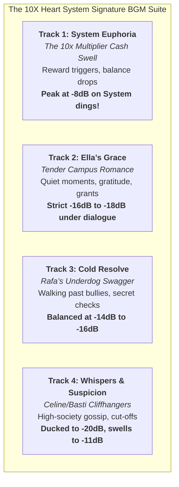

# Mini Drama Series Video Editing & Assembly Playbook

Reference guide for editing vertical mini-drama series (TikTok / Reels / Shorts / Serye, e.g. *The 10X Heart System*, *Pintig ng Puso*) with HermiEditor.

---

## 1. Universal Trigger & Auto-Execution

When the user says:
> **"Edit this mini drama series"**

HermiEditor automatically recognizes this prompt as the direct execution trigger for the complete **PopUpLedger v3.0 Mode B: Mini Drama Series** pipeline with zero manual setup required.

### Autonomous Protocol Executed:
1. **Source Discovery**: Ingests raw clips from `inbox/<series_slug>/` across all episodes (e.g. `ep1`, `ep2`, `ep3`, `ep4`).
2. **AI Generation Flash Removal**: Pre-trims frame-0 to frame-3 reference image flash artifacts (0.0417s to 0.1667s) with tail cloned padding (`tpad=stop_mode=clone`).
3. **Prompt Leak Muting**: Mutes off-screen director or AI prompt vocal bleed using time-window volume filters (`volume='if(between(t,st,en),0,1)':eval=frame`).
4. **Cinematic Color Grading**: Applies rich filmic S-curve contrast, lifted blacks, teal shadow tint, and warm skin midtones.
5. **Thematic BGM Suite Mapping**: Ingests the 4 signature instrumental themes and mixes them with frame-accurate cue boundaries and dynamic sidechain ducking.
6. **Safe-Zone Subtitles**: Synchronizes frame-accurate dialogue subtitles in Liberation Sans Bold (46pt) at `MarginV=280` px in the lower third, clearing platform UI overlays.
7. **Unified Omnibus Compilation**: Concatenates all episodes into 1 unified feature film with MP4 chapter markers.
8. **Master & Mobile Deliverables**: Outputs pristine master (`<slug>-final.mp4`) and mobile-optimized stream (`<slug>-final-45mb.mp4`, < 45MB) tagged with `MEDIA:/home/john/Documents/hermieditor/outbox/<slug>-final-45mb.mp4`.

---

## 2. Signature 4-Theme BGM Suite Specifications

Mini drama series utilize a specialized 4-theme instrumental suite (optimized for Suno v3.5, Udio, and ElevenLabs Music) so spoken dialogue stays 100% crisp and intelligible:



### Mixing Rules & Levels:

1. **Track 1: System Euphoria (The 10x Multiplier Cash Swell)**:
   - **Characteristics**: Driving sub-bass, triumphant brass, energetic rhythm.
   - **Function**: System reward triggers, bank balance notifications, dopamine drops.
   - **Level Guideline**: Let Track 1 **peak at -8 dB** right when the system notification dings!
2. **Track 2: Ella’s Grace (Tender Campus Romance)**:
   - **Characteristics**: Intimate nylon piano arpeggios, warm acoustic strings, gentle melody.
   - **Function**: Quiet library/courtyard moments with Ella, genuine gratitude, no-strings-attached talks.
   - **Level Guideline**: Set Track 2 strictly at **-16 dB to -18 dB under dialogue**.
3. **Track 3: Cold Resolve (Rafa’s Underdog Swagger)**:
   - **Characteristics**: Steady acoustic guitar, unhurried electric piano, confident tempo.
   - **Function**: Rafa walking calmly past bullies, checking money/phone in secret, unbothered confidence.
   - **Level Guideline**: Balanced at **-14 dB to -16 dB**.
4. **Track 4: Whispers & Suspicion (Celine/Basti Cliffhangers)**:
   - **Characteristics**: Sub-bass tension, ticking analog clockwork pulse, dark string textures.
   - **Function**: High-society gossip, Celine spotting them across the hall, dramatic episode cut-offs.
   - **Level Guideline**: Ducked to **-20 dB** during dialogue; swelling to **-10 dB to -12 dB** during freeze-frame cut-offs.

---

## 3. Audio Engineering Discipline

- **STRICTLY NO SFX (Dialogue Primacy)**:
  - Do NOT inject synthetic drama braams, whooshes, gongs, or riser impacts unless the user explicitly asks for them. Spoken voice and natural foley lead the mix.
- **Dialogue Mastering Chain**:
  - Highpass filter at 80 Hz (`highpass=f=80`).
  - +2.5 dB vocal presence boost at 2.8 kHz with Q=1.5 (`equalizer=f=2800:t=q:w=1.5:g=2.5`).
  - Spoken dialogue boosted by 1.35x (`volume=1.35`).
- **BGM Vocal Notch Filter**:
  - Apply a 1.2 kHz parametric notch scoop (`equalizer=f=1200:t=q:w=1.5:g=-3.5`) on all background music tracks. This carves out the exact sonic corridor where human speech lives.
- **Dynamic Envelope Ducking**:
  - Use a 250ms RMS moving-average envelope follower on dialogue. When speech is active (envelope > 0.015), dynamically duck music by -3.5 dB to -6.5 dB. During dramatic pauses or freeze holds, restore full cue levels.
- **Master Normalization (EBU R128)**:
  - Normalized to broadcast standard **-14 to -16 LUFS** with True Peak at **-1.5 dBFS** (`loudnorm=I=-14:LRA=7:TP=-1.5`).

---

## 4. Visual Grading & Transition Grammar

- **Cinematic Color Grading**:
  ```bash
  curves=m='0/0 0.18/0.14 0.5/0.51 0.82/0.85 1/1':r='0/0 0.5/0.52 1/1':b='0/0.02 0.5/0.49 1/0.98',colorbalance=rs=-0.02:gs=0.00:bs=0.02:rm=0.03:gm=0.01:bm=-0.02:rh=0.02:gh=0.01:bh=-0.01,eq=saturation=1.06:contrast=1.04
  ```
  - Filmic S-curve with lifted deep blacks.
  - Teal shadow tint (`bs=+0.02, rs=-0.02`).
  - Warm skin midtones (`rm=+0.03, gm=+0.01`).
  - Subtle golden specular highlights.
- **Transition Grammar**:
  - **Continuous Action/Dialogue**: Hard cuts (no transition) to preserve conversational cadence, eyelines, and confrontational pacing.
  - **Location / Scene Shifts**: Dip to black (0.4s–0.5s fade-out, 0.4s–0.5s fade-in) for physical relocations (cafeteria to walkway, stairwell to courtyard) or dramatic scene breaths.
  - **Cliffhangers**: 1.5s freeze-frame hold (`tpad=stop_mode=clone:stop_duration=1.5`) on the final dramatic reveal/countdown, followed by a 1.2s fade-to-black.

---

## 5. Subtitles & Safe-Zone Conformity

- **Style**: Simple, static, elegant 1-line-at-a-time subtitles (strictly NO bouncing karaoke).
- **Font**: Liberation Sans Bold (46pt).
- **Colors**:
  - Dialogue: Pure White (`&H00FFFFFF`) with 3.0px dark outline stroke and 1.2px drop shadow.
  - System HUD: Cyan/Gold (`&H00D7FFFF`) for diegetic system notifications.
- **Safe Zone**: Lower-third center (`MarginV=280` on 1080x1920) to clear TikTok, Reels, and YouTube Shorts UI navigation overlays without covering actors' chests.
- **Deliverables**: Burned into master video + companion `.ass` and `.srt` sidecars in `outbox/`.

---

## 6. Multi-Episode Marathon Feature Compilation

- Compile all series episodes into 1 unified feature film with embedded MP4 chapter markers.
- Write `ffmetadata.txt`:
  ```ini
  ;FFMETADATA1
  title=The 10X Heart System - Complete Feature (Episodes 1-4)
  artist=Antigravity (Agy)
  genre=Mini Drama Series

  [CHAPTER]
  TIMEBASE=1/1000
  START=0
  END=87500
  title=Episode 1: The Boy Who Ate Garbage
  ```
- Fast remux with `-c:v copy -map_metadata <meta_index>` preserves pristine video quality with zero re-encoding generation loss.

---

## 7. Deliverables & Telegram Media Delivery

- Master Render: `/home/john/Documents/hermieditor/outbox/<slug>-final.mp4` (1080x1920 @ 24fps, CRF 18, Burned Subs).
- Mobile Stream: `/home/john/Documents/hermieditor/outbox/<slug>-final-45mb.mp4` (< 45MB, 880k video / 96k audio) for instant playback on mobile Telegram.
- Final Tag: Always append `MEDIA:/home/john/Documents/hermieditor/outbox/<slug>-final-45mb.mp4` to automatically deliver the video directly to John in Telegram.
